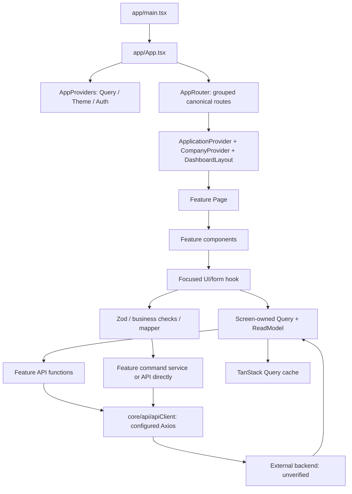
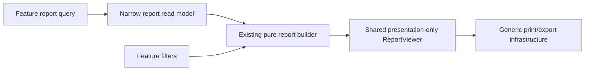

# تدفق البيانات والتنفيذ — المعمارية الحالية

هذه وثيقة إعادة الهيكلة؛ لا تثبت أن Backend أو قاعدة بيانات مطابقين للعقود. المصدر والفحوصات المنفذة هما الدليل. البيانات المرجعية والمحاكاة موجودة في tests فقط.

## قبل الفصل وبعده

السلسلة القديمة كانت: API resources → orchestration عام → mergeResources → FeatureDataScope → useErpContext → الشاشة/التقرير. أزيلت هذه التنفيذات والأنواع؛ لم تُنقل البيانات الضخمة إلى shared باسم آخر.

`ApplicationProvider` يملك الفرع والتنقل والتحرير وقفل إرسال الأمر وإعادة المحاولة والإبطال؛ لا يحتوي جداول ERP. `CompanyProvider` يملك فقط بيانات shell: المنشأة والهوية البصرية والفروع والدفاتر وسياسة النسخ. كل شاشة تطلب بياناتها مباشرةً؛ هذا المزود ليس مصدر بيانات أعمال الشاشات.

## قراءة شاشة

1. Page يحدد الشاشة/الوضع صراحةً. لا يختار component ضخم محتواه بتحليل URL.
2. hook يستخدم `useQueryIdentity`: المستخدم ونوع الهوية واللغة والفرع، ثم الدفتر الفعلي من `booksQuery`.
3. شاشة/تقرير يركّب query options مسماة لموارده فقط، ويكوّن read model مملوكًا له. يوجد cache مستقل لكل مورد.
4. API يرسل HTTP الفعلي. `readAllPages` يُستخدم صراحةً للحسابات والتصدير اللذين كانا يتطلبان كامل السجل؛ يتحقق من العدد والفهرس والنطاق والمراجعة والإلغاء. ليس تجميع ERP عامًا.
5. قيم rows/metadata تعود إلى الشاشة، مع Suspense وerror boundary. شروط تحميل auth مستقلة عن بيانات المنشأة.

شكل مفتاح المورد: `['erp', logicalOwner, resourceId, userId, userKind, bookId, branchScope, locale]`. يبقى branchScope فارغًا في قراءات الدفتر المصرّح بها التي تحتاج حسابات قديمة عبر الفروع؛ هذه ليست دعوى أن الخادم يفرض العزل. تُطبّق المرشحات الحالية داخل الحسابات؛ يلزم اختبار الخادم فعليًا قبل الاعتماد الأمني. التقارير/الطلبات المحددة بفرع تضيفه لمفتاحها وطلبها حين يدعمه العقد.

القراءة الكاملة ليست الحل النهائي لكل حجم بيانات: نقل التجميع والترقيم إلى endpoints تقارير مثبتة يحتاج Backend متاحًا وأمثلة تكافؤ؛ لم يُستبدل حساب قديم بعقد OpenAPI غير مثبت.

## مثال: إضافة عميل

`CreateCustomerPage` → `CustomerDirectoryView` / `useCustomerDirectoryController` → editor hook → `useValidatedForm` مع Zod → **قيم resolver الفعلية** → `useSaveCustomer` → تحميل بيانات التحقق الضرورية عند الحفظ → قواعد السنة والعملة والاسم عبر mapper يثبت `kind=customer` → `customers-service.saveCustomer` → `customers-api.submitCustomer` → `apiClient.post` إلى مسار الأمر الموجود → backend.

`useCommandMutation` ينتظر التحقق غير المتزامن قبل الإرسال. ينسّق `ApplicationProvider.runCommand` الصلاحية الحالية، قفل الإرسال، idempotency ID والمراجعة. بعد نجاح HTTP ينتظر invalidation للموارد المتأثرة ثم يعرض النجاح. عند 409 يُحدّث القراءة؛ وبعد خطأ شبكة بلا status يحتفظ بمعرف إعادة المحاولة للمدخل نفسه. معاني backend لهذه الضوابط غير مثبتة إلا في fixtures.

المورد لا يحمل المخزون لفتح نموذج العميل. بيانات التحقق منفصلة عن القراءة عند فتح الشاشة؛ يثبت browser test عدم طلب `/inventory/*` في رحلة العميل.

## المستخدمون والمصادقة

`UserListPage` و`CreateUserPage` و`EditUserPage` شاشات مستقلة. `UserFormFields` مشترك؛ `useUserEditor` يستخدم RHF + Zod ويختار `usersApi.create/update`. API functions تحدد POST/PUT/DELETE والموقع المحدد للمعرّف. تغيير كلمة المرور وإلغاء الجلسات لهما عمليات auth مسماة، وليسا generic action dispatcher. قيم `action` اللازمة للعقد القديم لا تزال داخل body دون تغيير معناها.

استرجاع الجلسة يُحقن في core AuthProvider من تركيب التطبيق؛ core لا يستورد feature. Axios يحافظ على withCredentials وإعداد CSRF/refresh الموجودين. نجاح المحاكاة لا يثبت HttpOnly/SameSite أو revocation على الخادم.

## التقارير

بقيت 192 حالة مرجعية مستقلة للتقارير. عرض/جمع أعمدة جدول والطباعة عامان؛ قواعد ERP والفلاتر المتخصصة وبناء مستند الفاتورة/السند/المخزون مملوكة لنطاقها. لا يستورد ReportViewer نموذج ERP أو محاسبة/مخزون/مبيعات.

## قيود يجب عدم تفسيرها كنجاح Backend

- المصدر المتاح frontend وعقود HTTP؛ لا توجد قاعدة بيانات أو backend قابلان للتحقق.
- المقارنة تثبت المحافظة على النتائج المرجعية؛ لا تصدّق صحة الحسابات المالية قانونيًا أو محاسبيًا.
- `readAllPages` وبعض الحسابات عبر كامل الدفتر تكلفة موروثة جرى جعلها صريحة، وليست pagination خادمية جديدة.
- English متاح لهيكل اللغة واتجاه الصفحة والتنقل الرئيسي. النصوص التجارية العربية لم تُترجم جميعًا؛ لا يُدّعى اكتمال localization لكل الميزات.
- `public/` مقصود؛ لا يضمن الاسم وحده السلامة. `check:architecture` يفحص المسارات الفعلية والدورات بما فيها feature type imports.

## ترتيب CSS

مدخل bootstrap الوحيد `app/styles.css`. كل @import في بداية ملفه وفق CSS/Vite، مع ترتيب 26 import يركّب core foundation و13 جزءًا لتنسيق التطبيق و12 جزءًا مملوكًا للميزات. هذا يحفظ ترتيب cascade الأصلي بدل نقل overrides إلى نهاية الملف. راجع GLOBAL_STYLE_ORDER.json لإثبات تسلسل القواعد والتصريحات؛ check:architecture يمنع import متأخرًا أو مدخل CSS إضافيًا.
